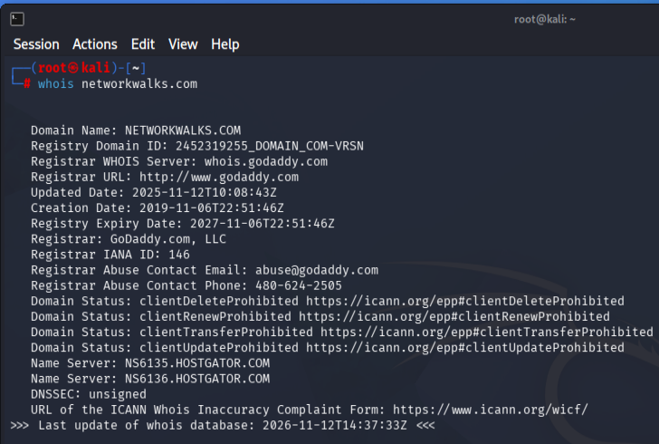
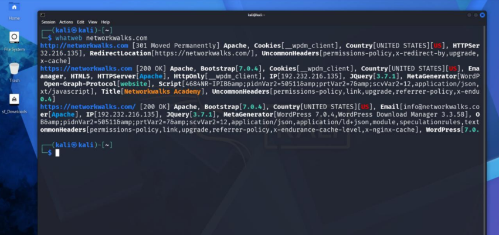
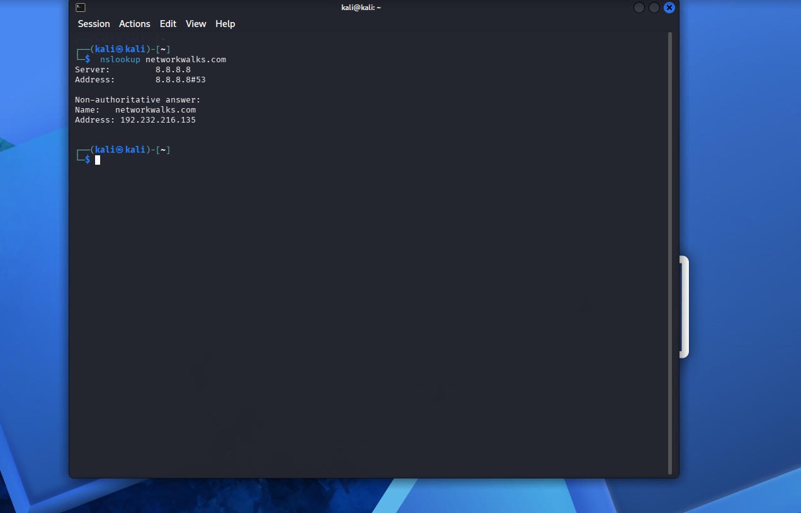
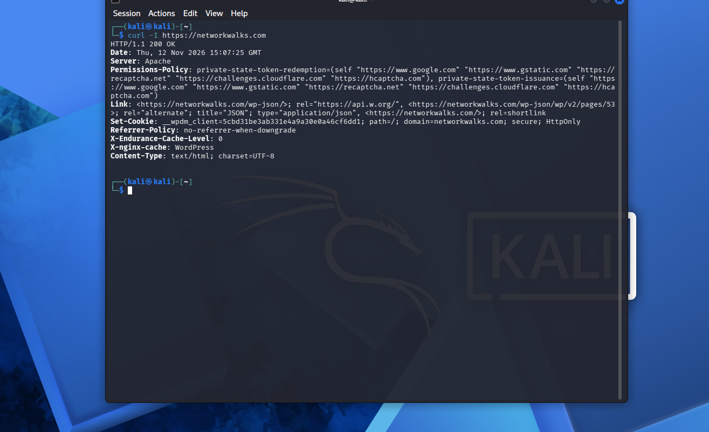
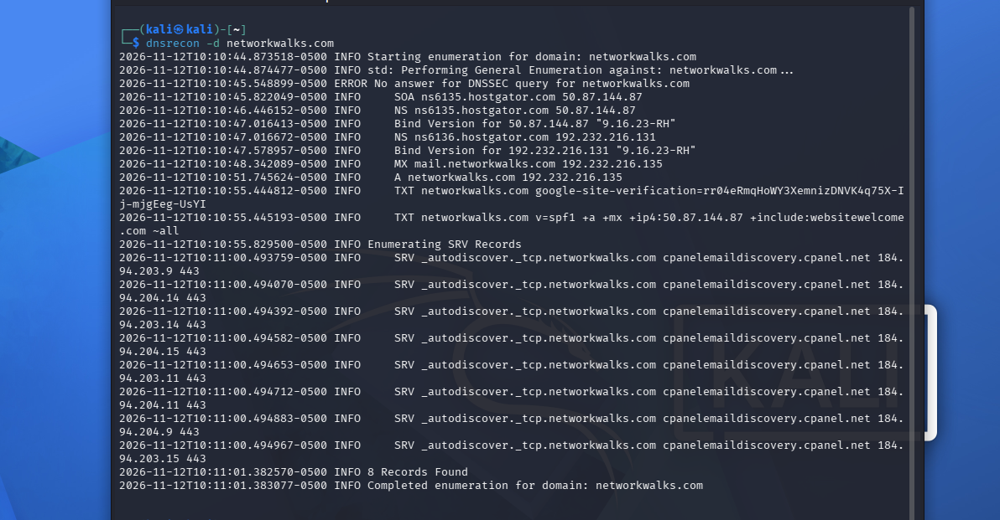
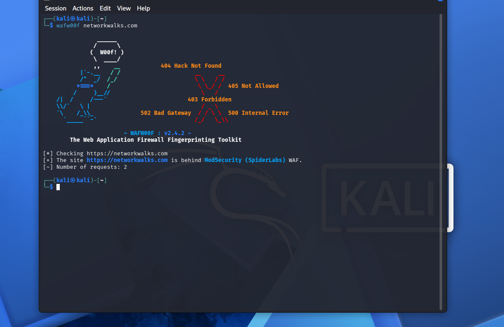

# 🔐 PENETRATION TESTING REPORT
### Footprinting & Reconnaissance

**W2-PM-FINAL | CYBERSECURITY | NETWORKWALKS**

---

## 📌 Project Information

| Field | Details |
|---|---|
| Program | Cybersecurity & Ethical Hacking |
| Organization | Networkwalks |
| Week | 02 |
| Date | 12 November 2026 |
| Operating System | Kali Linux |
| Target Domain | networkwalks.com |
| Practical Focus | Footprinting & Reconnaissance |

---

## 1. Liability Disclaimer

All activities documented in this repository were performed as part of an educational cybersecurity practical within the assigned authorized scope.

The tools and techniques demonstrated are intended strictly for educational and research purposes. Unauthorized testing against systems or networks without appropriate permission is prohibited.

The author is not responsible for any misuse of the information provided in this repository.

---

## 2. Introduction

This repository documents the practical implementation of footprinting and reconnaissance techniques using multiple Kali Linux tools as part of Week 02 of the Cybersecurity & Ethical Hacking program at Networkwalks.

The primary objective was to understand how publicly available information about a domain can be collected and analyzed using different reconnaissance tools.

During this practical, I used six Kali Linux tools to gather information about domain registration, DNS records, server configuration, website technologies, HTTP response headers, and Web Application Firewall identification.

The practical activities included:

- WHOIS – Domain Information Gathering
- WhatWeb – Website Technology Fingerprinting
- Nslookup – DNS Lookup
- cURL – HTTP Header Analysis
- DNSRecon – DNS Enumeration
- Wafw00f – Web Application Firewall Detection

Each activity was performed through the Kali Linux terminal, and the results were documented with screenshots as practical evidence.

---

## 3. Tools Used

| Tool | Purpose |
|---|---|
| WHOIS | Collect domain registration information. |
| WhatWeb | Identify website technologies and CMS information. |
| Nslookup | Resolve domain names into IP addresses. |
| cURL | Inspect HTTP response headers. |
| DNSRecon | Enumerate DNS records. |
| Wafw00f | Identify Web Application Firewall technologies. |

---

## 4. Activities Performed

### 4.1 WHOIS – Domain Information Gathering

**Command:**

```bash
whois networkwalks.com
```

**Objective:**

To collect publicly available domain registration information.

**Observations:**

- Registrar: GoDaddy.com, LLC
- Domain Creation Date: 06 November 2019
- Domain Expiry Date: 06 November 2027
- Name Servers:
  - NS6135.HOSTGATOR.COM
  - NS6136.HOSTGATOR.COM
- DNSSEC: Unsigned

**Result:**

WHOIS provided information about domain registration, registrar details, domain status, and associated name servers.

**Evidence:**



---

### 4.2 WhatWeb – Website Technology Fingerprinting

**Command:**

```bash
whatweb networkwalks.com
```

**Objective:**

To identify the technologies and software used by the target website.

**Observations:**

- Web Server: Apache
- CMS: WordPress 7.1.4
- WordPress Download Manager: 3.3.76
- Bootstrap: 7.1.4
- jQuery: 3.7.1
- Website IP: 192.232.216.135
- HTTPS Response: 200 OK

**Result:**

WhatWeb successfully identified several technologies and components associated with the website.

**Evidence:**



---

### 4.3 Nslookup – DNS Lookup

**Command:**

```bash
nslookup networkwalks.com
```

**Objective:**

To resolve the domain name into its corresponding IP address.

**Observations:**

- DNS Server: 8.8.8.8
- Domain: networkwalks.com
- Resolved IP Address: 192.232.216.135

**Result:**

The command successfully resolved the domain name and returned its associated IP address.

**Evidence:**



---

### 4.4 cURL – HTTP Header Analysis

**Command:**

```bash
curl -I https://networkwalks.com
```

**Objective:**

To inspect the HTTP response headers returned by the website.

**Observations:**

- HTTP Response: 200 OK
- Web Server: Apache
- Content-Type: text/html
- WordPress REST API endpoint: `/wp-json/`
- Additional security and caching headers were observed.

**Result:**

cURL successfully retrieved the HTTP response headers and provided information about the website's server and application configuration.

**Evidence:**



---

### 4.5 DNSRecon – DNS Enumeration

**Command:**

```bash
dnsrecon -d networkwalks.com
```

**Objective:**

To enumerate DNS records associated with the target domain.

**Observations:**

DNSRecon identified the following record categories:

- SOA Records
- NS Records
- A Records
- MX Records
- TXT Records
- SRV Records

Additional observations:

- DNS server software version information was identified.
- The DNSSEC query returned no answer.
- Total records reported: 8.

**Result:**

DNSRecon successfully completed general DNS enumeration and provided information about the domain's DNS infrastructure.

**Evidence:**



---

### 4.6 Wafw00f – Web Application Firewall Detection

**Command:**

```bash
wafw00f networkwalks.com
```

**Objective:**

To identify whether a Web Application Firewall protects the target website.

**Observations:**

- WAF Detection: Successful
- Identified WAF: ModSecurity (SpiderLabs)
- Number of Requests: 2

**Result:**

Wafw00f identified ModSecurity (SpiderLabs) as the Web Application Firewall protecting the website.

**Evidence:**



---

## 5. Risk Analysis / Impact

Based on the information collected during reconnaissance, the following potential security observations were identified.

| No. | Finding | Potential Impact | Risk Level |
|---|---|---|---|
| 1 | Website technology information exposed | Helps identify software and technologies for further security review. | Medium |
| 2 | Server IP address identifiable | Provides information about hosting infrastructure. | Low |
| 3 | HTTP technical information exposed | May assist technology fingerprinting. | Low |
| 4 | WAF technology identifiable | Reveals information about the website's security architecture. | Low |
| 5 | DNS infrastructure information exposed | Helps build a broader infrastructure profile. | Medium |

**Note:** These are observations from reconnaissance activities, not confirmed vulnerabilities. No exploitation or vulnerability validation was performed.

---

## 6. Recommendations

Based on the observations, the following security improvements are recommended:

1. Regularly review publicly exposed website technology information.
2. Keep CMS platforms, plugins, and server software updated.
3. Review HTTP response headers to minimize unnecessary information disclosure.
4. Regularly review publicly accessible DNS records.
5. Properly configure and monitor the Web Application Firewall.
6. Conduct periodic security assessments within an authorized scope.
7. Monitor infrastructure and investigate unexpected changes.

---

## 7. Conclusion

During Week 02 of the Cybersecurity & Ethical Hacking program at Networkwalks, I performed practical exercises involving domain footprinting and reconnaissance using multiple Kali Linux tools.

I learned how WHOIS provides domain registration information, WhatWeb identifies website technologies, Nslookup resolves domain names, cURL examines HTTP headers, DNSRecon enumerates DNS records, and Wafw00f detects Web Application Firewalls.

These exercises helped me understand the importance of reconnaissance in cybersecurity and how publicly available information can provide valuable insights into a target's digital infrastructure.

I also gained practical experience using Kali Linux, executing reconnaissance commands, interpreting terminal outputs, and documenting technical findings.

---

## 8. Evidence Collected

All practical screenshots are included in this repository.

| No. | Screenshot | Tool |
|---|---|---|
| 01 | 01-whois.png | WHOIS |
| 02 | 02-whatweb.png | WhatWeb |
| 03 | 03-nslookup.png | Nslookup |
| 04 | 04-curl-headers.png | cURL |
| 05 | 05-dnsrecon.png | DNSRecon |
| 06 | 06-wafw00f.png | Wafw00f |

---

## 9. Repository Structure

```text
Week-02-Penetration-Testing/
│
├── README.md
│
├── 01-whois.png
├── 02-whatweb.png
├── 03-nslookup.png
├── 04-curl-headers.png
├── 05-dnsrecon.png
└── 06-wafw00f.png
```

---

## 👤 Author

**Gaurav Ambare**

Cybersecurity & Ethical Hacking Trainee

**Organization:** Networkwalks

**Program:** Cybersecurity Program | Week 02

---

*This repository is intended for educational and research purposes only.*
