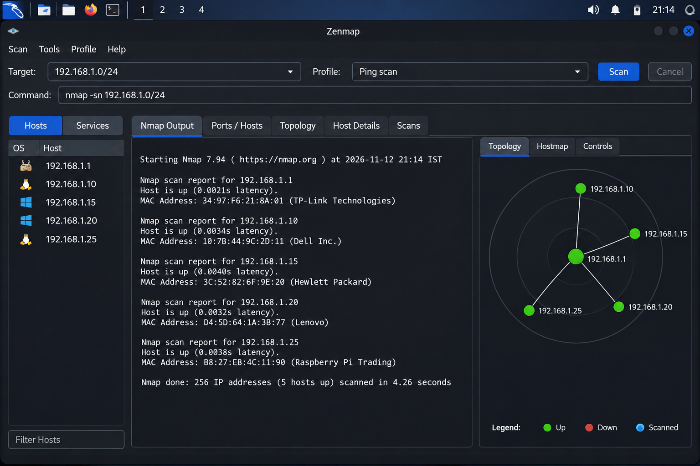

# Networkwalks – Week 02: Footprinting, Reconnaissance & Network Scanning

**Name:** Gaurav Vijay Ambare  
**Batch:** B084D  
**Program:** Cybersecurity & Ethical Hacking  
**Organization:** Networkwalks  
**Week:** 02  
**Date:** 12 November 2026

---

## 1. Liability Disclaimer

This report has been prepared for educational purposes as part of the Networkwalks Cybersecurity & Ethical Hacking internship program.

The activities documented in this report focus on information gathering, footprinting, reconnaissance and network scanning concepts.

All testing should be performed only on systems and networks for which proper authorization has been obtained.

---

## 2. Introduction

During Week 02 of the internship, I explored various footprinting, reconnaissance and network scanning techniques using Kali Linux tools.

The objective was to understand how publicly available information about a domain can be collected and analyzed. I explored DNS information, HTTP response headers, website technologies and Web Application Firewall detection.

The practical activities involved using WHOIS, WhatWeb, Nslookup, Curl, DNSRecon, Wafw00f and Zenmap.

---

## 3. Tools Used

| Tool | Purpose |
|---|---|
| WHOIS | Domain registration information |
| WhatWeb | Website technology identification |
| Nslookup | DNS resolution |
| Curl | HTTP header analysis |
| DNSRecon | DNS enumeration |
| Wafw00f | Web Application Firewall detection |
| Zenmap | Network scanning and topology visualization |

---

## 4. Activities Performed

### 4.1 WHOIS – Domain Information Gathering

WHOIS was used to collect domain registration information for `networkwalks.com`.

**Command:**
```bash
whois networkwalks.com
```

**Observations:**
- Registrar: GoDaddy.com, LLC
- Creation Date: 06 November 2019
- Expiry Date: 06 November 2027
- Name Servers: NS6135.HOSTGATOR.COM and NS6136.HOSTGATOR.COM
- DNSSEC: Unsigned

**Evidence:**


---

### 4.2 WhatWeb – Website Technology Identification

WhatWeb was used to identify the technologies and frameworks used by the target website.

**Command:**
```bash
whatweb https://networkwalks.com
```

**Observations:**
- Web Server: Apache
- CMS: WordPress
- WordPress Version: 7.1.4
- jQuery Version: 3.7.1
- Website IP: 192.232.216.135
- HTTP to HTTPS redirection was observed.

**Evidence:**


---

### 4.3 Nslookup – DNS Enumeration

Nslookup was used to resolve the domain name into its corresponding IP address.

**Command:**
```bash
nslookup networkwalks.com
```

**Observations:**
- DNS Server: 8.8.8.8
- Resolved IP Address: 192.232.216.135

**Evidence:**


---

### 4.4 Curl – HTTP Header Analysis

Curl was used to inspect HTTP response headers and understand how the web server responds to requests.

**Command:**
```bash
curl -I https://networkwalks.com
```

**Observations:**
- HTTP Response: 200 OK
- Web Server: Apache
- WordPress REST API endpoint was observed.
- HTTP response headers were examined.

**Evidence:**


---

### 4.5 DNSRecon – DNS Enumeration

DNSRecon was used to collect DNS records associated with the target domain.

**Command:**
```bash
dnsrecon -d networkwalks.com
```

**Observations:**
- SOA records were identified.
- NS records were identified.
- MX records were identified.
- A records were identified.
- TXT records were identified.
- DNSSEC query returned no answer.
- A total of 8 DNS records were reported.

**Evidence:**


---

### 4.6 Wafw00f – Web Application Firewall Detection

Wafw00f was used to identify whether the target website was protected by a Web Application Firewall.

**Command:**
```bash
wafw00f https://networkwalks.com
```

**Observations:**
- ModSecurity was identified.
- Detection was associated with SpiderLabs.
- Two HTTP requests were used during detection.

**Evidence:**


---

### 4.7 Zenmap – Network Scanning and Topology Visualization

Zenmap is the graphical interface of Nmap. It provides a visual interface for network scanning, host discovery and topology visualization.

The interface includes scan profiles, host information, Nmap output and a graphical topology view.

**Evidence:**



---

## 5. Risk Analysis and Impact

The reconnaissance activities provided information that could be useful for understanding the target website's publicly visible infrastructure.

| Observation | Potential Impact |
|---|---|
| Public domain registration information | Provides domain registration details |
| Identifiable website technologies | May help identify outdated software |
| Public DNS records | Reveals domain infrastructure information |
| Visible HTTP response headers | Provides information about the web server |
| ModSecurity detection | Indicates an existing security protection layer |

**Note:** These observations do not confirm the presence of exploitable vulnerabilities.

---

## 6. Recommendations

1. Keep website software, CMS platforms and plugins updated.
2. Review DNS records periodically.
3. Avoid exposing unnecessary server information through HTTP headers.
4. Maintain properly configured Web Application Firewall rules.
5. Monitor domain registration and DNS configurations.
6. Conduct regular security assessments.
7. Follow secure configuration and patch management practices.

---

## 7. Conclusion

During Week 02, I gained practical exposure to footprinting, reconnaissance and network scanning concepts using Kali Linux tools.

I learned how to collect domain registration information, identify website technologies, perform DNS enumeration, inspect HTTP headers and detect Web Application Firewall technologies.

I also explored Zenmap and its graphical interface for network scanning and topology visualization.

Overall, these activities improved my understanding of information gathering techniques and the initial stages of penetration testing.

---

## 8. Evidence Collection

The following screenshots are included as supporting evidence:

1. WHOIS – `01-whois.png`
2. WhatWeb – `02-whatweb.png`
3. Nslookup – `03-nslookup.png`
4. Curl – `04-curl-headers.png`
5. DNSRecon – `05-dnsrecon.png`
6. Wafw00f – `06-wafw00f.png`
7. Zenmap – `07-zenmap-scan.png`

---

**Repository:** NETWORKWALKS-B084D-WK2  
**Program:** Cybersecurity & Ethical Hacking – Networkwalks
